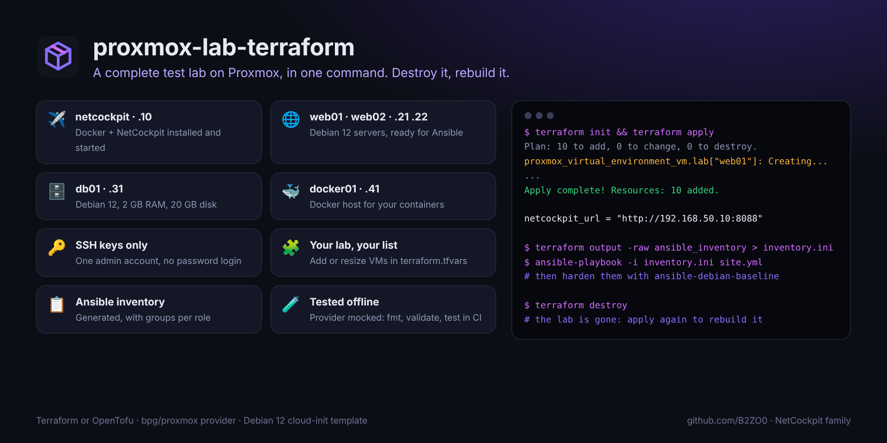

<div align="center">


# proxmox-lab-terraform

### Un lab de test complet sur Proxmox, en une commande. Casse-le, détruis-le, reconstruis-le.

**Des VM Debian 12 depuis un modèle cloud-init, des adresses fixes, des clés SSH, Docker là où tu le veux,<br>NetCockpit déjà installé, et un inventaire Ansible prêt à l'emploi.**

[](https://github.com/B2ZO0/proxmox-lab-terraform/actions/workflows/ci.yml)
[](LICENSE)


[English](README.md) · **Français**



</div>

---

## Pourquoi ?

Un lab, c'est l'endroit où on apprend sans peur : tester un rôle Ansible, une règle de pare-feu, une migration, une supervision. Le monter à la main prend une soirée, et on n'ose jamais le casser. Avec ce projet, le lab est une liste dans un fichier : `terraform apply` le construit, `terraform destroy` le supprime, et tu recommences autant de fois que tu veux.

## ✨ Ce que tu obtiens

| VM | Rôle | Taille par défaut | Ce qui est installé |
|---|---|---|---|
| `netcockpit` · .10 | `netcockpit` | 2 vCPU · 4 Go · 30 Go | Docker et [NetCockpit](https://github.com/B2ZO0/netcockpit), démarré : ouvre `http://<ip>:8088` |
| `web01`, `web02` · .21 .22 | `server` | 1 vCPU · 1 Go · 12 Go | Debian 12, prête pour Ansible |
| `db01` · .31 | `server` | 1 vCPU · 2 Go · 20 Go | Debian 12, prête pour Ansible |
| `docker01` · .41 | `docker` | 2 vCPU · 2 Go · 30 Go | Docker |

Chaque VM reçoit le même compte admin avec tes clés SSH (pas de connexion par mot de passe), l'agent invité QEMU, son fuseau horaire et des tags Proxmox (`lab`, son rôle, tes tags). Modifie la liste dans `terraform.tfvars` pour construire le lab que tu veux.

## 🚀 Démarrage rapide

**1. Une seule fois, sur le nœud Proxmox** (en root) : crée le modèle cloud-init Debian 12 et autorise les snippets sur le stockage `local`.

```bash
wget https://raw.githubusercontent.com/B2ZO0/proxmox-lab-terraform/main/scripts/create-debian-template.sh
bash create-debian-template.sh 9000 local-lvm vmbr0
```

**2. Un jeton d'API pour Terraform** (Centre de données → Permissions → Jetons API), par exemple `terraform@pve!lab` avec les rôles *PVEVMAdmin* et *PVEDatastoreUser*. Terraform envoie aussi les fichiers cloud-init en SSH : charge ta clé SSH dans ton agent (`ssh-add`).

**3. Depuis ton ordinateur :**

```bash
git clone https://github.com/B2ZO0/proxmox-lab-terraform.git && cd proxmox-lab-terraform
cp terraform.tfvars.example terraform.tfvars     # adresse, réseau, clé SSH, tes VM
export TF_VAR_proxmox_api_token='terraform@pve!lab=xxxxxxxx-xxxx-xxxx-xxxx-xxxxxxxxxxxx'

terraform init
terraform apply
```

Tout fonctionne de la même façon avec `tofu` (OpenTofu).

**4. Utiliser le lab :**

```bash
terraform output vms                                   # noms, ID, adresses, commandes SSH
terraform output -raw ansible_inventory > inventory.ini
ansible -i inventory.ini lab -m ping
terraform destroy                                      # quand tu as fini
```

L'inventaire contient un groupe `lab` et un groupe par rôle (`role_server`, `role_docker`, `role_netcockpit`) : applique [ansible-debian-baseline](https://github.com/B2ZO0/ansible-debian-baseline) pour durcir les serveurs, fais surveiller le réseau du lab par NetCockpit, casse des choses, et observe.

## ⚙️ Variables principales

Toutes les variables sont documentées dans [`variables.tf`](variables.tf).

| Variable | Par défaut | Description |
|---|---|---|
| `proxmox_endpoint` | | Adresse de l'API, ex. `https://pve.lab.local:8006/` |
| `proxmox_api_token` | | Jeton, de préférence dans `TF_VAR_proxmox_api_token` |
| `node_name` | `pve` | Nœud Proxmox |
| `template_id` | `9000` | Modèle cloud-init créé par le script |
| `vm_id_start` | `800` | Premier ID de VM ; les autres suivent |
| `datastore` / `bridge` / `vlan_id` | `local-lvm` / `vmbr0` / aucun | Où vont les VM |
| `network_cidr` / `gateway` | `192.168.50.0/24` / `.1` | Réseau du lab ; chaque VM prend son `host_number` |
| `ssh_public_keys` | | Obligatoire : qui peut se connecter |
| `vms` | 5 VM | `host_number`, `role`, `cores`, `memory_mb`, `disk_gb`, `tags` |

La configuration refuse les erreurs avant de toucher à Proxmox : un rôle inconnu, deux VM à la même adresse, aucune clé SSH.

## 🧪 Testé

À chaque modification, avec **Terraform et OpenTofu** : `fmt`, `validate` et `test` avec le fournisseur Proxmox **simulé**, pour vérifier le plan (ID des VM, adresses, contenu cloud-init, inventaire, erreurs refusées) sans aucun serveur Proxmox.

## ✈️ De la famille NetCockpit

De petits outils ciblés pour les admins, du débutant au pro, par l'auteur de [**NetCockpit**](https://github.com/B2ZO0/netcockpit), le cockpit en direct de toute ton infrastructure.

| Outil | Ce qu'il fait |
|---|---|
| [NetCockpit](https://github.com/B2ZO0/netcockpit) | Topologie en direct, VMware, switchs, alertes et journaux dans un seul cockpit |
| [ad-audit-report](https://github.com/B2ZO0/ad-audit-report) | Bilan de santé de l'Active Directory sur une page HTML |
| [ansible-debian-baseline](https://github.com/B2ZO0/ansible-debian-baseline) | Un serveur Debian prêt pour la production en un playbook |
| [netconfig-backup](https://github.com/B2ZO0/netconfig-backup) | Les configurations Cisco, FortiGate et UniFi versionnées dans Git |
| [sysadmin-toolbox](https://github.com/B2ZO0/sysadmin-toolbox) | Les outils PowerShell du quotidien pour les admins Windows |
| [proxmox-lab-terraform](https://github.com/B2ZO0/proxmox-lab-terraform) | Ce projet : un lab de test sur Proxmox en une commande |

## 🤝 Contribuer

Un modèle Windows Server, un routeur OPNsense, un lab Kubernetes ? [Ouvre un ticket](https://github.com/B2ZO0/proxmox-lab-terraform/issues). Les pull requests sont les bienvenues.

Si ce lab t'a fait gagner une soirée, une ⭐ aide d'autres admins à le trouver.

---

<sub>Fait par [Enzo Marechal](https://enzomarechal.fr) ([@B2ZO0](https://github.com/B2ZO0)), administrateur système et réseau junior. Licence MIT.</sub>
