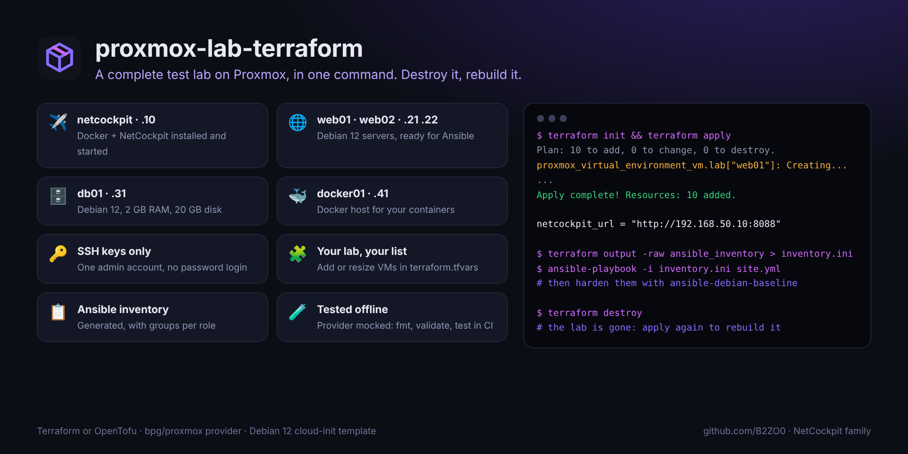

<div align="center">


# proxmox-lab-terraform

### A complete test lab on Proxmox, in one command. Break it, destroy it, rebuild it.

**Debian 12 VMs from a cloud-init template, fixed addresses, SSH keys, Docker where you want it,<br>NetCockpit already installed, and an Ansible inventory ready to use.**

[](https://github.com/B2ZO0/proxmox-lab-terraform/actions/workflows/ci.yml)
[](LICENSE)


[](https://github.com/B2ZO0/proxmox-lab-terraform/stargazers)

**English** · [Français](README.fr.md)



</div>

---

## Why?

A lab is where you learn without fear: test an Ansible role, a firewall rule, a migration, a monitoring setup. Building it by hand takes an evening, and you never dare to break it. With this project the lab is a list in a file: `terraform apply` builds it, `terraform destroy` removes it, and you can start again as often as you like.

## ✨ What you get

| VM | Role | Default size | What is installed |
|---|---|---|---|
| `netcockpit` · .10 | `netcockpit` | 2 vCPU · 4 GB · 30 GB | Docker and [NetCockpit](https://github.com/B2ZO0/netcockpit), started: open `http://<ip>:8088` |
| `web01`, `web02` · .21 .22 | `server` | 1 vCPU · 1 GB · 12 GB | Debian 12, ready for Ansible |
| `db01` · .31 | `server` | 1 vCPU · 2 GB · 20 GB | Debian 12, ready for Ansible |
| `docker01` · .41 | `docker` | 2 vCPU · 2 GB · 30 GB | Docker |

Every VM gets the same admin account with your SSH keys (no password login), the QEMU guest agent, its time zone, and Proxmox tags (`lab`, its role, your tags). Change the list in `terraform.tfvars` to build any lab you want.

## 🚀 Quick start

**1. Once, on the Proxmox node** (as root): create the Debian 12 cloud-init template and allow snippets on the `local` storage.

```bash
wget https://raw.githubusercontent.com/B2ZO0/proxmox-lab-terraform/main/scripts/create-debian-template.sh
bash create-debian-template.sh 9000 local-lvm vmbr0
```

**2. An API token for Terraform** (Datacenter → Permissions → API Tokens), for example `terraform@pve!lab` with the *PVEVMAdmin* and *PVEDatastoreUser* roles. Terraform also uploads the cloud-init files over SSH: load your SSH key in your agent (`ssh-add`).

**3. From your computer:**

```bash
git clone https://github.com/B2ZO0/proxmox-lab-terraform.git && cd proxmox-lab-terraform
cp terraform.tfvars.example terraform.tfvars     # endpoint, network, SSH key, your VMs
export TF_VAR_proxmox_api_token='terraform@pve!lab=xxxxxxxx-xxxx-xxxx-xxxx-xxxxxxxxxxxx'

terraform init
terraform apply
```

Everything works the same with `tofu` (OpenTofu).

**4. Use the lab:**

```bash
terraform output vms                                   # names, IDs, addresses, SSH commands
terraform output -raw ansible_inventory > inventory.ini
ansible -i inventory.ini lab -m ping
terraform destroy                                      # when you are done
```

The inventory has a `lab` group and one group per role (`role_server`, `role_docker`, `role_netcockpit`): apply [ansible-debian-baseline](https://github.com/B2ZO0/ansible-debian-baseline) to harden the servers, point NetCockpit at the lab network, break things, and watch.

## ⚙️ Main variables

All variables are documented in [`variables.tf`](variables.tf).

| Variable | Default | Description |
|---|---|---|
| `proxmox_endpoint` | | API URL, e.g. `https://pve.lab.local:8006/` |
| `proxmox_api_token` | | Token, better set as `TF_VAR_proxmox_api_token` |
| `node_name` | `pve` | Proxmox node |
| `template_id` | `9000` | Cloud-init template made by the script |
| `vm_id_start` | `800` | First VM ID; the others follow |
| `datastore` / `bridge` / `vlan_id` | `local-lvm` / `vmbr0` / none | Where the VMs go |
| `network_cidr` / `gateway` | `192.168.50.0/24` / `.1` | Lab network; each VM uses its `host_number` |
| `ssh_public_keys` | | Required: who can log in |
| `vms` | 5 VMs | `host_number`, `role`, `cores`, `memory_mb`, `disk_gb`, `tags` |

The configuration refuses mistakes before touching Proxmox: an unknown role, two VMs on the same address, no SSH key.

## 🔒 Security notes

This is a **lab**: some defaults favour convenience over hardening. Keep it on an isolated network or VLAN.

- `proxmox_insecure = true` accepts the self-signed certificate of Proxmox. With a trusted certificate, set it to `false`.
- The admin account has **passwordless sudo** and Docker is installed with the official `get.docker.com` script.
- The API token only needs VM and datastore rights: never use `root@pam`. Pass it as `TF_VAR_proxmox_api_token`, and keep `terraform.tfvars` and `*.tfstate` out of Git (they are in `.gitignore`).
- NetCockpit asks for a password: it is shown in `/var/log/netcockpit-setup.log` on the netcockpit VM (readable by root only).

## 🧪 Tested

At every push, with **Terraform and OpenTofu**: `fmt`, `validate`, and `test` with the Proxmox provider **mocked**, so the tests check the plan (VM IDs, addresses, cloud-init content, inventory, refused mistakes) without any Proxmox server.

## ✈️ Part of the NetCockpit family

Small, focused tools for sysadmins, from beginners to pros, by the author of [**NetCockpit**](https://github.com/B2ZO0/netcockpit), a live cockpit for your whole infrastructure.

| Tool | What it does |
|---|---|
| [NetCockpit](https://github.com/B2ZO0/netcockpit) | Live topology, VMware, switches, alerts and logs in one cockpit |
| [ad-audit-report](https://github.com/B2ZO0/ad-audit-report) | Active Directory health check in one HTML page |
| [ansible-debian-baseline](https://github.com/B2ZO0/ansible-debian-baseline) | A production-ready Debian server in one playbook |
| [netconfig-backup](https://github.com/B2ZO0/netconfig-backup) | Cisco, FortiGate and UniFi configs, versioned in Git |
| [sysadmin-toolbox](https://github.com/B2ZO0/sysadmin-toolbox) | Everyday PowerShell tools for Windows admins |
| [proxmox-lab-terraform](https://github.com/B2ZO0/proxmox-lab-terraform) | This project: a test lab on Proxmox in one command |

## 🤝 Contributing

A Windows Server template, an OPNsense router, a Kubernetes lab? [Open an issue](https://github.com/B2ZO0/proxmox-lab-terraform/issues). Pull requests are welcome.

If this lab saved you an evening, a ⭐ helps other admins find it.

---

<sub>Made by [Enzo Marechal](https://enzomarechal.fr) ([@B2ZO0](https://github.com/B2ZO0)), junior system and network administrator. MIT license.</sub>
